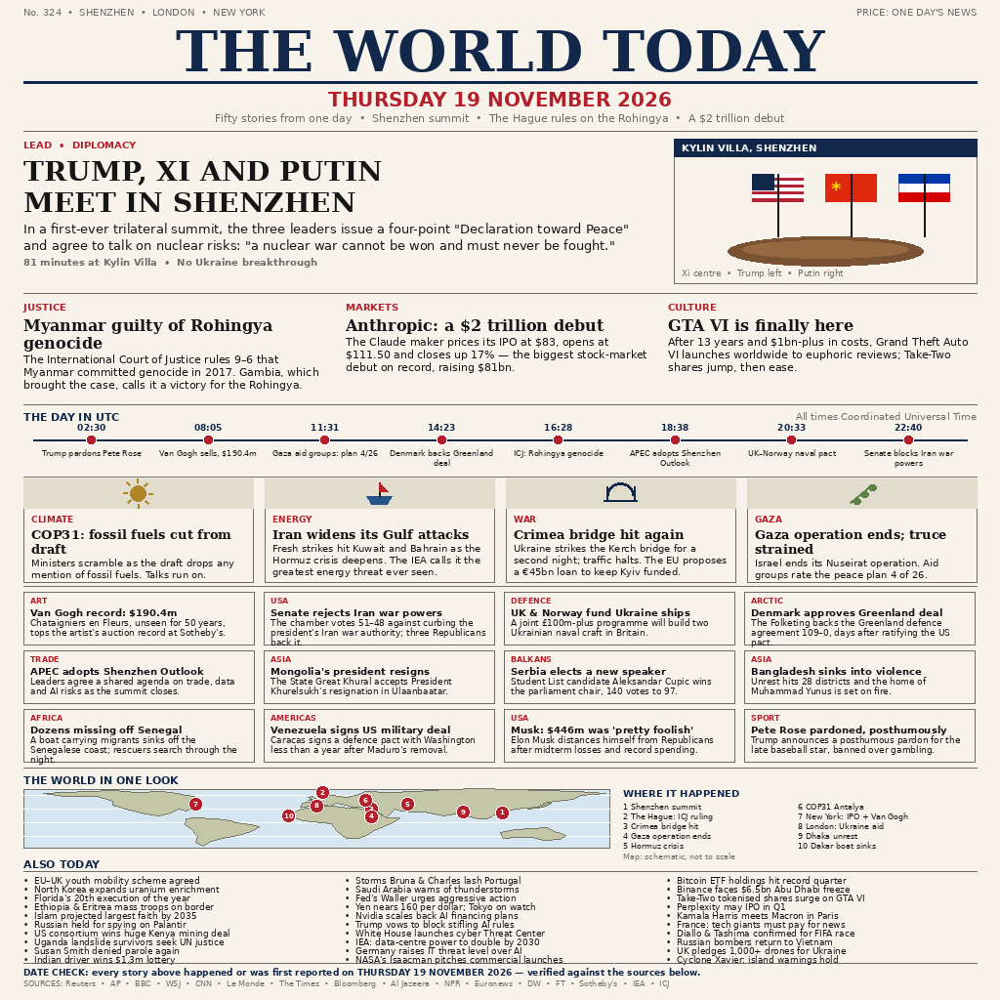

# THE WORLD TODAY — Thursday 19 November 2026

[](https://make.fun/c/news-image-20261119)
[](https://make.fun/c/news-image-20261119)
[](https://make.fun/c/news-image-20261119)

One image summing up the world's news of **Thursday 19 November 2026** — fifty stories on a single broadsheet front page, for the [news-image-20261119](https://make.fun/c/news-image-20261119) competition on [make.fun](https://make.fun).



## What's on the page

- **Lead:** the first-ever trilateral summit of Trump, Xi and Putin in Shenzhen — an 81-minute meeting at Kylin Villa and a four-point "Declaration toward Peace", including the line that "a nuclear war cannot be won and must never be fought."
- **Row two:** the International Court of Justice rules 9–6 that Myanmar committed genocide against the Rohingya; Anthropic's record IPO ($83 priced, $111.50 open, about a $2 trillion valuation); Grand Theft Auto VI launches after 13 years.
- **The day in UTC:** an eight-point timeline, from the Pete Rose pardon (02:30) to the Senate's rejection of the Iran war-powers resolution (22:40).
- **Four heroes:** COP31 drops fossil fuels from its draft deal; Iran widens its Gulf attacks; Ukraine hits the Crimea bridge again; the Gaza ground operation ends as the truce strains.
- **Twelve cards, a pinned world map, and a thirty-item tail list** — from a record $190.4m Van Gogh to a migrant boat sinking off Senegal.
- **DATE CHECK footer:** every story above happened, or was first reported, on Thursday 19 November 2026, verified against the sixteen sources named at the foot of the page.

## How it works

`main.ts` (Node 22, standard library only) copies the shipped `entry.png` to `/output/entry.png`. The image is drawn in advance with a local script and committed to the repository, so both grading runs produce byte-identical output — the copy is fully deterministic and needs no network. Run it locally with:

```sh
mkdir -p out && MAKEFUN_OUTPUT_DIR=out node main.ts
```

## Sources

Reuters, AP, BBC, WSJ, CNN, Le Monde, The Times, Bloomberg, Al Jazeera, NPR, Euronews, DW, FT, Sotheby's, IEA, ICJ.

---

Built for [make.fun](https://make.fun/r/rkkz4bh8) — [news-image-20261119](https://make.fun/c/news-image-20261119).
